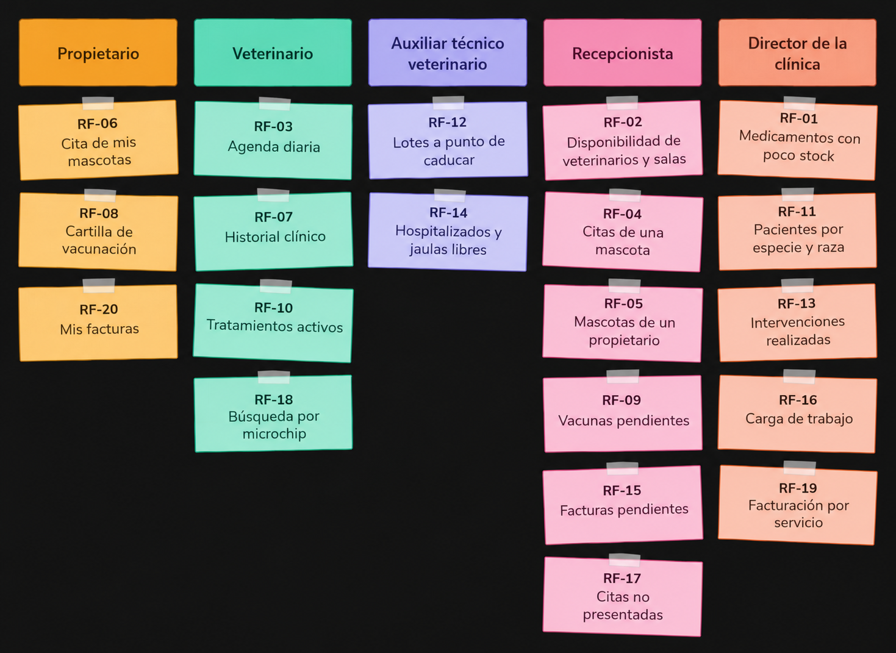

# Sistema de información para la gestión de una clínica veterinaria

## Miembros del grupo L1-DF-AM-1

1. López Núñez, Mario
2. Yáñez López, José Luis
3. Romero Zurdo, Roberto

## 1. Introducción al problema

La Clínica Veterinaria Reina es una clínica situada en Sevilla que cuenta con 4 consultas, 2 quirófanos, 8 jaulas de hospitalización y un equipo de 8 veterinarios, 4 auxiliares técnicos veterinarios y 2 recepcionistas. Atiende principalmente a animales domésticos.

Sus servicios incluyen consultas generales, de especialidad, vacunación y desparasitación, cirugía, hospitalización, urgencias y dispensación de medicamentos. Con aproximadamente 550 pacientes registrados y una media de 180 citas semanales, la gestión de agendas, historiales clínicos, existencias de medicamentos y facturación resulta cada vez más difícil de gestionar de forma manual. El objetivo de este proyecto es desarrollar un sistema de información que centralice y ordene esa gestión.

Actualmente las citas se anotan en una agenda de papel y los historiales clínicos se guardan en documentos sueltos. El control de vacunas y de la cartilla sanitaria depende de la memoria del personal y de anotaciones. El stock de medicamentos se revisa a mano y la facturación se realiza con plantillas manuales.

Con esta forma de trabajar se han detectado los siguientes problemas:

- Citas solapadas o mal asignadas entre veterinarios y salas.
- Historiales clínicos dispersos que dificultan conocer los antecedentes y los tratamientos en curso de un paciente.
- Olvido de recordatorios de vacunación y desparasitación, con la consiguiente pérdida de clientes y riesgo para los animales.
- Falta de control del stock de medicamentos y de sus fechas de caducidad, con roturas de stock o productos caducados.
- Poca trazabilidad de los lotes de vacunas y medicamentos administrados o dispensados.
- Facturas pendientes difíciles de reclamar.
- Pacientes duplicados o con datos incompletos, por ejemplo con el microchip mal anotado.

La clínica espera un sistema que evite las incoherencias en las citas, conserve un historial clínico completo y consultable de cada animal, facilite la gestión de vacunas y medicamentos y en definitiva, acabe con los problemas mencionados anteriormente.

## 2. Glosario de términos

- **Alta:** finalización de una hospitalización, tras la cual el animal regresa con su propietario.
- **Anestesia:** procedimiento que se aplica al animal para que no sienta dolor durante una intervención quirúrgica o una prueba.
- **Cartilla sanitaria:** documento que recoge las vacunas, desparasitaciones y otros datos de salud de una mascota.
- **Colegiado:** veterinario habilitado para ejercer, identificado por su número de colegiado.
- **Consentimiento informado:** documento firmado por el propietario en el que autoriza una intervención quirúrgica tras haber sido informado de sus riesgos.
- **Desparasitación:** tratamiento preventivo o curativo contra parásitos internos o externos.
- **Esterilización:** intervención que impide la reproducción del animal.
- **Historial clínico:** conjunto de consultas, diagnósticos, tratamientos, vacunas e intervenciones de un paciente.
- **Intervención quirúrgica:** operación realizada por un veterinario en el quirófano.
- **Jaula:** espacio de la zona de hospitalización donde se aloja a un animal ingresado.
- **Lote:** conjunto de unidades de un medicamento o vacuna producida juntas, identificado por un código y una fecha de caducidad.
- **Microchip:** dispositivo con un código numérico único implantado bajo la piel del animal para identificarlo.
- **Receta:** prescripción veterinaria necesaria para dispensar determinados medicamentos.

## 3. Visión general del sistema

### 3.1. Requisitos generales

#### R.G.01. Gestionar citas

Como **recepcionista,**\
quiero **gestionar las citas de veterinarios y salas,**\
para **organizar la actividad diaria de la clínica sin errores ni solapamientos.**

#### R.G.02. Gestionar mascotas

Como **recepcionista,**\
quiero **gestionar las mascotas con su propietario titular,**\
para **identificar correctamente a cada paciente y evitr duplicados.**

#### R.G.03. Gestionar historial clínico

Como **veterinario,**\
quiero **gestionar el historial clínico de cada mascota con sus consultas, diagnñostios y tratamientos,**\
para **atenderla con todos sus antecedentes.**

#### R.G.04. Gestionar vacunaciones.

Como **veterinario,**\
quiero **llevar el control de las vacunas que se aplican a cada mascota,**\
para **cumplir con el calendario sanitario de cada animal.**

#### R.G.05. Gestionar medicamentos.

Como **auxiliar técnico veterinario,**\
quiero **gestionar los medicamentos y sus lotes,**\
para **controlar las existencias y evitar el uso de productos caducados.**

### 3.2. Usuarios del sistema

- **Propietario:** responsable de una o varias mascotas.
- **Veterinario:** profesional colegiado que atiende a los pacientes.
- **Auxiliar técnico veterinario:** personal de apoyo clínico.
- **Recepcionista:** personal de atención al público y administración.
- **Director de la clínica:** responsable de la gestión.

## 4. Catálogo de requisitos

### 4.1. Requisitos funcionales

#### R.F.01. Crear cita

Como **recepcionista,**\
quiero **crear una cita para una mascota con un veterinario y una sala en una fecha y hora concretas,**\
para **organizar la agenda de la clínica.**

#### R.F.02. Disponibilidad de veterinarios y salas

Como **recepcionista,**\
quiero **consultar qué veterinarios y salas están libres en una fecha y franja horaria,**\
para **dar citas sin solapamientos.**

#### R.F.03. Agenda diaria

Como **veterinario,**\
quiero **consultar mi agenda diaria con la mascota, la sala y el motivo de cada cita,**\
para **preparar mi jornada.**

#### R.F.04. Citas de una mascota

Como **recepcionista,**\
quiero **listar las citas pasadas y futuras de una mascota,**\
para **informar al propietario.**

#### R.F.05. Mascotas de un propietario

Como **recepcionista,**\
quiero **listar las mascotas de un propietario con su especie, raza y edad,**\
para **identificar rápidamente al paciente.**

#### R.F.06. Cita de mis mascotas

Como **propietario,**\
quiero **consultar las citas pasadas y futuras de mis mascotas,**\
para **organizarme y no olvidar ninguna cita.**

#### R.F.07. Historial clínico

Como **veterinario,**\
quiero **consultar el historial clínico completo de una mascota (consultas, diagnósticos, tratamientos, vacunas e intervenciones),**\
para **atenderla con todos sus antecedentes.**

#### R.F.08. Cartilla de vacunación

Como **propietario,**\
quiero **consultar la cartilla de vacunación de mi mascota con las fechas de aplicación y las próximas dosis,**\
para **mantener sus vacunas al día.**

#### R.F.09. Vacunas pendientes

Como **recepcionista,**\
quiero **listar las mascotas con vacunas pendientes o próximas a vencer en un periodo, con los datos de contacto de los propietarios,**\
para **avisar a los propietarios.**

#### R.F.10. Tratamientos activos

Como **veterinario,**\
quiero **listar los tratamientos activos de una mascota,**\
para **evitar duplicar o contraindicar medicación.**

#### R.F.11. Pacientes por especie y raza

Como **director de la clínica,**\
quiero **consultar el número de pacientes por especie y raza,**\
para **planificar servicios y compras.**

#### R.F.12. Lotes a punto de caducar

Como **auxiliar técnico veterinario,**\
quiero **listar los lotes de medicamentos y vacunas caducados o que caducan en un periodo,**\
para **usarlos a tiempo o retirarlos.**

#### R.F.13. Intervenciones realizadas

Como **director de la clínica,**\
quiero **listar las intervenciones quirúrgicas de un periodo, por veterinario o por tipo,**\
para **evaluar la actividad quirúrgica.**

#### R.F.14. Hospitalizados y jaulas libres

Como **auxiliar técnico veterinario,**\
quiero **listar los animales hospitalizados y las jaulas libres,**\
para **organizar los ingresos.**

#### R.F.15. Facturas pendientes

Como **recepcionista,**\
quiero **listar las facturas pendientes o vencidas, de un propietario o de todos, con su importe,**\
para **reclamar los pagos.**

#### R.F.16. Carga de trabajo

Como **director de la clínica,**\
quiero **consultar cuántas citas ha atendido cada veterinario en un periodo,**\
para **repartir mejor la carga de trabajo.**

#### R.F.17. Citas no presentadas

Como **recepcionista,**\
quiero **listar los propietarios con citas no presentadas en un periodo,**\
para **aplicar las políticas de la clínica.**

#### R.F.18. Búsqueda por microchip

Como **veterinario,**\
quiero **buscar una mascota por su número de microchip,**\
para **identificar un animal con certeza.**

#### R.F.19. Facturación por servicio

Como **director de la clínica,**\
quiero **consultar la facturación de un periodo agrupada por tipo de servicio,**\
para **conocer qué servicios generan más ingresos.**

#### R.F.20. Mis facturas

Como **propietario,**\
quiero **consultar mis facturas pendientes y pagadas con su importe y fecha,**\
para **saber qué debo abonar a la clínica.**

#### 4.1.1. Requisitos de información

##### R.I.01. Información de personas

Como **recepcionista,**\
quiero **disponer de la siguiente información sobre las personas registradas en la clínica:**

- DNI O NIF
- Nombre y apellidos
- Teléfono
- Correo electrónico
- Dirección

##### R.I.02. Información de propietarios

Como **recepcionista,**\
quiero **disponer de la siguiente información sobre los propietarios:**

- Fecha de alta
- Preferencia de contacto (teléfono o correo electrónico)

##### R.I.03. Información de veterinarios

Como **director de la clínica,**\
quiero **disponer de la siguiente información sobre los veterinarios:**

- Número de colegiado
- Especialidad (medicina general, cirugía, dermatología...)
- Fecha de contratación

##### R.I.04. Información del personal auxiliar y administrativo

Como **director de la clínica,**\
quiero **disponer de la siguiente información sobre el personal auxiliar y administrativo:**

- Puesto (auxiliar técnico veterinario, recepcionista)
- Titulación, si la tiene
- Fecha de contratación

##### R.I.05. Información de especies

Como **veterinario,**\
quiero **disponer de la siguiente información sobre las especies atendidas:**

- Nombre de la especie (perro, gato, conejo, ave...)

##### R.I.06. Información de mascotas

Como **veterinario,**\
quiero **disponer de la siguiente información sobre las mascotas:**

- Nombre
- Especie y raza
- Sexo
- Color
- Fecha de nacimiento
- Número de microchip
- Si está esterilizada
- Estado (viva o fallecida) y fecha de fallecimiento, si se ha producido
- Propietario titular

##### R.I.07. Información de salas

Como **recepcionista,**\
quiero **disponer de la siguiente información sobre las salas de la clínica:**

- Nombre
- Tipo (consulta, quirófano o zona de pruebas)
- Estado (operativa o fuera de servicio)

##### R.I.08. Información de servicios

Como **director de la clínica,**\
quiero **disponer de la siguiente información sobre los servicios que ofrece la clínica:**

- Código y nombre
- Tipo (consulta, vacunación, cirugía, analítica, hospitalización...)
- Duración estimada en minutos.
- Precio base.

##### R.I.09. Información de citas

Como **recepcionista,**\
quiero **disponer de la siguiente información sobre las citas:**

- Mascota y veterinario
- Sala
- Fecha, hora de inicio y duración
- Tipo y motivo
- Si es una urgencia
- Estado (programada, cancelada, no presentada o atendida)

##### R.I.10. Información de consultas clínicas

Como **veterinario,**\
quiero **disponer de la siguiente información sobre cada cita atendida:**

- Peso
- Temperatura
- Síntomas
- Diagnóstico
- Observaciones

##### R.I.11. Información de medicamentos

Como **director de la clínica,**\
quiero **disponer de la siguiente información sobre los medicamentos:**

- Código, nombre comercial y principio activo
- Si requiere receta
- Precio
- Unidades en stock y stock mínimo

##### R.I.12. Información de lotes de medicamentos

Como **auxiliar técnico veterinario,**\
quiero **disponer de la siguiente información sobre los lotes de medicamentos:**

- Medicamento
- Código de lote
- Fecha de caducidad
- Unidades disponibles

##### R.I.13. Información de tratamientos

Como **veterinario,**\
quiero **disponer de la siguiente información sobre los tratamientos:**

- Consulta clínica en la que se prescribe
- Medicamento
- Dosis y frecuencia
- Fecha de inicio y fecha de fin
- Instrucciones

##### R.I.14. Información de vacunas

Como **veterinario,**\
quiero **disponer de la siguiente información sobre las vacunas:**

- Nombre
- Enfermedades que previene
- Especies para las que está indicada
- Periodicidad de las dosis

##### R.I.15. Información de las vacunaciones

Como **veterinario,**\
quiero **disponer de la siguiente información sobre las vacunaciones:**

- Mascota y vacuna
- Veterinario que la administra
- Fecha de aplicación
- Código del lote y fecha de caducidad del lote
- Fecha de la próxima dosis

##### R.I.16. Información de intervenciones quirúrgicas

Como **veterinario,**\
quiero **disponer de la siguiente información sobre las intervenciones quirúrgicas:**

- Cita en la que se realiza
- Tipo de intervención
- Quirófano
- Tipo de anestesia
- Hora de inicio y de fin
- Resultado
- Consentimiento informado (firmado o no, y fecha de la firma)

##### R.I.17. Información de jaulas

Como **auxiliar técnico veterinario,**\
quiero **disponer de la siguiente información sobre las jaulas:**

- Número
- Tamaño (pequeña, mediana o grande)
- Estado (libre, ocupada o en limpieza)

##### R.I.18. Información de hospitalizaciones

Como **veterinario,**\
quiero **disponer de la siguiente información sobre las hospitalizaciones:**

- Mascota y jaula
- Fecha y hora de ingreso y de alta
- Motivo
- Estado

##### R.I.19. Información de facturas

Como **recepcionista,**\
quiero **disponer de la siguiente información sobre las facturas:**

- Número
- Propietario
- Fecha de emisión y fecha de vencimiento
- Importe total
- Forma de pago
- Estado (pendiente, pagada o vencida)

#### 4.1.2. Reglas de negocio

##### R.N.01. Sin solapamientos de veterinario

Como **director de la clínica,**\
quiero **que un veterinario no pueda tener dos citas cuyos horarios se solapen,**\
para **evitar errores de agenda.**

**Prueba de aceptación**
- La Dra. A tiene una cita de 10:00 a 10:30. Se solicita otra cita con la Dra. A de 10:30 a 11:00 el mismo día y se acepta.
- La Dra. A tiene una cita de 10:00 a 10:30. Se solicita otra con la Dra. A de 10:15 a 10:45 y se recibe un mensaje de error por solape.
- La Dra. A tiene una cita cancelada de 10:00 a 10:30. Se solicita otra con la Dra. A de 10:00 a 10:30 y se acepta.

##### R.N.02. Sin solapamientos de sala

Como **director de la clínica,**\
quiero **que una sala no pueda tener dos citas cuyos horarios se solapen,**\
para **no sobreocupar consultas ni quirófanos.**

**Prueba de aceptación**
- La consulta 1 tiene una cita de 10:00 a 10:30. Se solicita una cita con el Dr. B en la consulta 1 de 10:00 a 10:30 y se recibe un mensaje de error.
- La consulta 1 tiene una cita de 10:00 a 10:30. Se solicita una cita con el Dr. B en la consulta 2 de 10:00 a 10:30 y se acepta.

##### R.N.03. Horario de la clínica

Como **director de la clínica,**\
quiero **que las citas no urgentes comiencen y terminen dentro del horario de la clínica (de lunes a viernes de 09:00 a 20:00 y los sábados de 09:00 a 14:00),**\
para **respetar los turnos del personal.**

**Prueba de aceptación**
- Se solicita una cita de 13:30 a 14:00 un sábado y se acepta.
- Se solicita una cita no urgente de 13:45 a 14:15 un sábado y se recibe un mensaje de error.
- Se solicita una cita no urgente un domingo a las 11:00 y se recibe un mensaje de error.
- Se registra una urgencia un domingo a las 11:00 y se acepta.

##### R.N.04. Duración de las citas

Como **recepcionista,**\
quiero **que la duración de una cita sea múltiplo de 15 minutos, que las consultas y vacunaciones duren como máximo 30 minutos y que las cirugías duren al menos 60,**\
para **planificar la agenda de forma realista.**

**Prueba de aceptación**
- Se solicita una consulta de 30 minutos y se acepta.
- Se solicita una consulta de 45 minutos y se recibe un mensaje de error.
- Se solicita una cirugía de 90 minutos y se acepta; una cirugía de 30 minutos se rechaza.

##### R.N.05. Citas en el pasado

Como **recepcionista,**\
quiero **que no se puedan programar citas en el pasado, salvo urgencias que se registran una vez atendidas,**\
para **evitar errores al registrar citas.**

**Prueba de aceptación**
- Se solicita una cita no urgente para ayer y se recibe un mensaje de error.
- Se registra una urgencia atendida hace una hora y se acepta.

##### R.N.06. Vacunas por especie

Como **veterinario,**\
quiero **que una vacuna solo pueda administrarse a mascotas de las especies para las que está indicada,**\
para **evitar errores de vacunación.**

**Prueba de aceptación**
- Se administra la vacuna de la rabia, indicada para perros, a un perro y se acepta.
- Se administra una vacuna indicada solo para perros a un gato y se recibe un mensaje de error.

### 4.2. Mapa de historias de usuario (opcional)

### 4.3. Requisitos no funcionales (opcional)

**R.N.F.01. Control de acceso**\
Como **veterinario,**\
quiero **que los datos clínicos solo sean accesibles para el personal clínico autorizado y, en el caso del propietario, para sus propias mascotas,**\
para **proteger la privacidad.**

**R.N.F.02. Trazabilidad de lotes**\
Como **veterinario,**\
quiero **poder vincular cada vacuna administrada y cada medicamento dispensado a su lote,**\
para **actuar con rapidez ante una retirada de producto.**

**R.N.F.03. Tiempo de respuesta**\
Como **recepcionista,**\
quiero **que la búsqueda por microchip y la consulta de la agenda diaria respondan en menos de 2 segundos,**\
para **no hacer esperar a los clientes.**

-- fin entregable 1 --

## 5. Modelo conceptual

### 5.1. Diagramas de clases UML

- con restricciones.

### 5.2. Escenarios de prueba

- con descripción textual y diagrama de objetos UML.

## 6. Matrices de trazabilidad

- Matriz de trazabilidad entre los elementos del modelo conceptual y los requisitos.

|       | EntidadX   | AsociaciónX  | RestricciónX  | Entidad2 ...   | 
|:------|:-----------|:-----------|:-----------|:-----------|
| RI-1  | X          | X          | X          | X          |
| RI-2  |            | X          |            | X          |
| RF-1  |            | X          |            | X          |
| RF-2  | X          |            | X          | X          |
| RN-1  |            | X          |            |            |
| RN-2  | X          | X          | X          |            |
| ...   |            |            |            |            |

-- fin entregable 2 --

## 7. Modelo relacional en 3FN

- Relaciones obtenidas al aplicar la transformación del modelo conceptual.

### 7.1.  Justificación de la estrategia de transformación de jerarquías

- si se identificaron jerarquías en el MC.

### 8. Matriz de trazabilidad MC/SQL (opcional):

- Restricciones sobre el MC / Elementos del modelo tecnológico (SQL) (Triggers, checks, etc.)
- Incluir Reglas de negocio — Constraints/Triggers en las matrices de trazabilidad para el entregable 3

|       | EntidadX   | AsociaciónX  | RestricciónX  | Entidad2 ...   | 
|:-------|:-------|:-------|:-------|:-------|
| TABLA-1 |        |        |        |        |
| TABLA-2 |        |        |        |        |
| TABLA-3 |        |        |        |        |
| TABLA-4 |        |        |        |        |
| TRIG-1 |        |        |        |        |
| TRIG-2 | X      | X      |        | X      |
| TRIG-3 |        | X      |        | X      |
| TRIG-4 |        |        | X      |        |
| CONST-1 |        |        |        |        |
| CONST-2 | X      | X      |        | X      |
| CONST-3 |        | X      |        | X      |
| CONST-4 |        |        | X      |        |

Se consideran todo tipo de constraints declarativas (aquellas definidas durante el CREATE TABLE).
-- fin entregable 3 --

## Referencias

