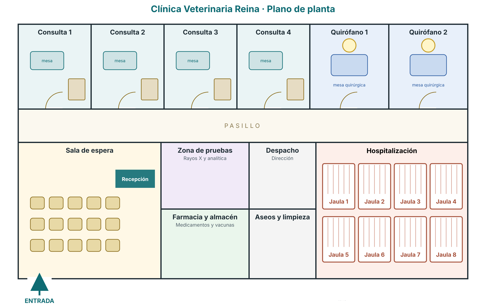
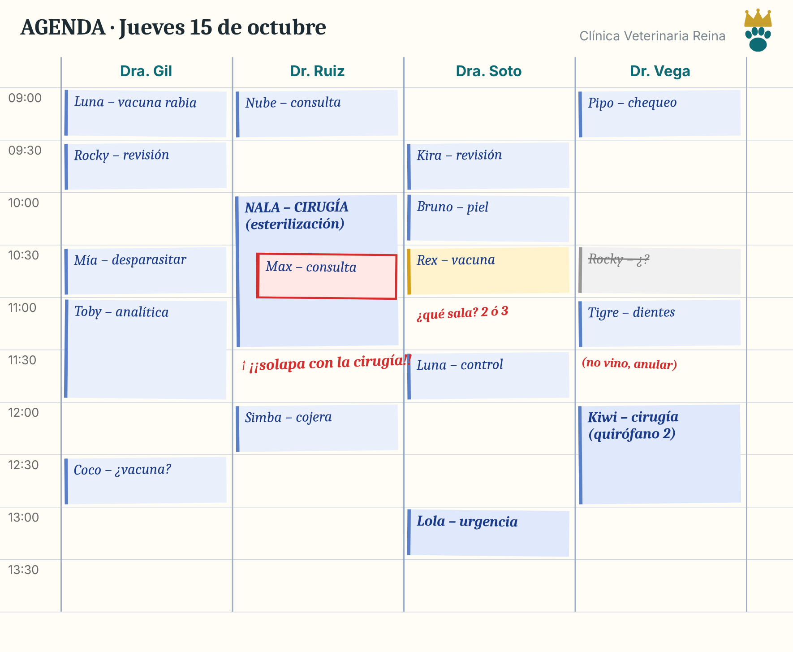
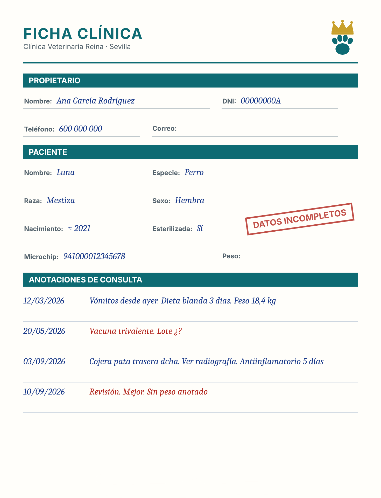
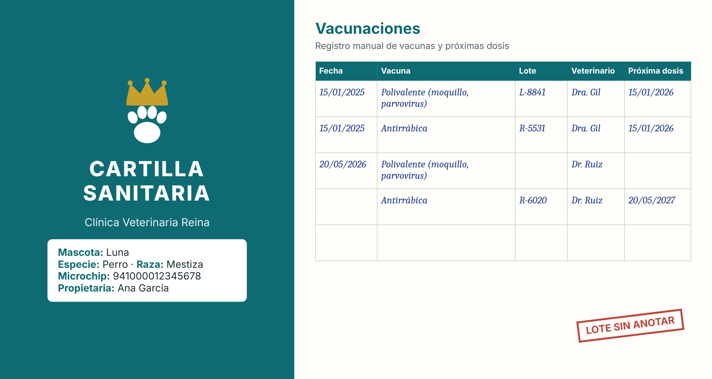
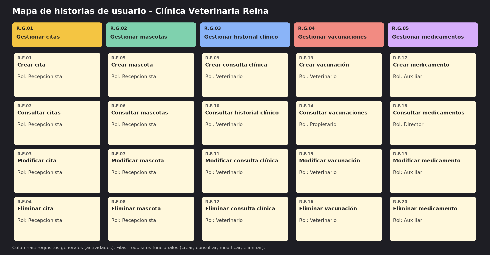

# Sistema de información para la gestión de una clínica veterinaria

## Miembros del grupo L1-DF-AM-1

1. López Núñez, Mario
2. Yáñez López, José Luis
3. Romero Zurdo, Roberto

## 1. Introducción al problema

La Clínica Veterinaria Reina es una clínica situada en Sevilla que cuenta con 4 consultas, 2 quirófanos, 8 jaulas de hospitalización y un equipo de 8 veterinarios, 4 auxiliares técnicos veterinarios y 2 recepcionistas. Atiende principalmente a animales domésticos.

Sus servicios incluyen consultas generales, de especialidad, vacunación y desparasitación, cirugía, hospitalización, urgencias y dispensación de medicamentos. Con aproximadamente 550 pacientes registrados y una media de 180 citas semanales, la gestión de agendas, historiales clínicos, existencias de medicamentos y facturación resulta cada vez más difícil de gestionar de forma manual. El objetivo de este proyecto es desarrollar un sistema de información que centralice y ordene esa gestión.

Actualmente las citas se anotan en una agenda de papel y los historiales clínicos se guardan en documentos sueltos. El control de vacunas y de la cartilla sanitaria depende de la memoria del personal y de anotaciones. El stock de medicamentos se revisa a mano y la facturación se realiza con plantillas manuales.

Con esta forma de trabajar se han detectado los siguientes problemas:

- Citas solapadas o mal asignadas entre veterinarios y salas.
- Historiales clínicos dispersos que dificultan conocer los antecedentes y los tratamientos en curso de un paciente.
- Olvido de recordatorios de vacunación y desparasitación, con la consiguiente pérdida de clientes y riesgo para los animales.
- Falta de control del stock de medicamentos y de sus fechas de caducidad, con roturas de stock o productos caducados.
- Poca trazabilidad de los lotes de vacunas y medicamentos administrados o dispensados.
- Facturas pendientes difíciles de reclamar.
- Pacientes duplicados o con datos incompletos, por ejemplo con el microchip mal anotado.

La clínica espera un sistema que evite las incoherencias en las citas, conserve un historial clínico completo y consultable de cada animal, facilite la gestión de vacunas y medicamentos y en definitiva, acabe con los problemas mencionados anteriormente.

## 2. Glosario de términos

- **Alta:** finalización de una hospitalización, tras la cual el animal regresa con su propietario.
- **Anestesia:** procedimiento que se aplica al animal para que no sienta dolor durante una intervención quirúrgica o una prueba.
- **Cartilla sanitaria:** documento que recoge las vacunas, desparasitaciones y otros datos de salud de una mascota.
- **Colegiado:** veterinario habilitado para ejercer, identificado por su número de colegiado.
- **Consentimiento informado:** documento firmado por el propietario en el que autoriza una intervención quirúrgica tras haber sido informado de sus riesgos.
- **Desparasitación:** tratamiento preventivo o curativo contra parásitos internos o externos.
- **Esterilización:** intervención que impide la reproducción del animal.
- **Historial clínico:** conjunto de consultas, diagnósticos, tratamientos, vacunas e intervenciones de un paciente.
- **Intervención quirúrgica:** operación realizada por un veterinario en el quirófano.
- **Jaula:** espacio de la zona de hospitalización donde se aloja a un animal ingresado.
- **Lote:** conjunto de unidades de un medicamento o vacuna producida juntas, identificado por un código y una fecha de caducidad.
- **Microchip:** dispositivo con un código numérico único implantado bajo la piel del animal para identificarlo.
- **Receta:** prescripción veterinaria necesaria para dispensar determinados medicamentos.

## 3. Visión general del sistema

### 3.1. Requisitos generales

#### R.G.01. Gestionar citas

Como **recepcionista,**\
quiero **gestionar las citas de veterinarios y salas,**\
para **organizar la actividad diaria de la clínica sin errores ni solapamientos.**

#### R.G.02. Gestionar mascotas

Como **recepcionista,**\
quiero **gestionar las mascotas con su propietario titular,**\
para **identificar correctamente a cada paciente y evitr duplicados.**

#### R.G.03. Gestionar historial clínico

Como **veterinario,**\
quiero **gestionar el historial clínico de cada mascota con sus consultas, diagnñostios y tratamientos,**\
para **atenderla con todos sus antecedentes.**

#### R.G.04. Gestionar vacunaciones.

Como **veterinario,**\
quiero **llevar el control de las vacunas que se aplican a cada mascota,**\
para **cumplir con el calendario sanitario de cada animal.**

#### R.G.05. Gestionar medicamentos.

Como **auxiliar técnico veterinario,**\
quiero **gestionar los medicamentos y sus lotes,**\
para **controlar las existencias y evitar el uso de productos caducados.**

### 3.2. Usuarios del sistema

- **Propietario:** responsable de una o varias mascotas.
- **Veterinario:** profesional colegiado que atiende a los pacientes.
- **Auxiliar técnico veterinario:** personal de apoyo clínico.
- **Recepcionista:** personal de atención al público y administración.
- **Director de la clínica:** responsable de la gestión.

## 4. Catálogo de requisitos

### 4.1. Requisitos funcionales

#### R.F.01. Crear cita

Como **recepcionista,**\
quiero **crear una cita para una mascota con un veterinario y una sala en una fecha y hora concretas,**\
para **organizar la agenda de la clínica.**

**Prueba de aceptación**
- Se crea una cita con mascota, veterinario, sala, fecha, hora de inicio, duración, tipo  y motivo, y aparece en la agenda como programada.
- Se intenta crear una cita sin mascota, sin veterinario o sin sala y se recibe un mensaje de error.
- La Dra. A tiene una cita de 10:00 a 10:30. Se intenta crear otra con la Dra. A de 10:15 a 10:45 y se recibe un mensaje de error.

#### R.F.02. Consultar citas.

Como **recepcionista,**\
quiero **consultar las citas de un día, de un veterinario o de una mascota, y ver qué veterinarios y salas están libres en una franja horaria,**\
para **informar al propietario y dar citas sin solapamientos.**

**Prueba de aceptación**
- La Dra. A tiene 3 citas hoy. Se consulta su agenda diaria y aparecen las 3 ordenadas por hora, con la mascota, la sala y el motivo.
- Una mascota tien 2 citas pasadas y 1 futura. Se consultan sus citas y aparecen las 3 ordenadas por fecha.

#### R.F.03. Modificar cita.

Como **recepcionista,**\
quiero **modificar la fecha, la hora, el veterinario o la sala de una cita, y cambiar su estado,**\
para **reprogramarla o reflejar si se ha atendido, cancelado o no se ha presentado el propietario.**

**Prueba de aceptación**
- Una cita programada de 10:00 a 10:30 se cambia a las 12:00 y, al consultarla, aparece con la nueva hora.
- Se intenta cambiar una cita a un horario en el que el veterinario ya tiene otra cita y se recibe un mensaje de error.
- Se cambia el estado de una cita programada a cancelada y su veterinario y su sala quedan libres a esa hora.
- Se cambia el estado de una cita programada a atendida y aparece como atendida.

#### R.F.04. Eliminar cita.

Como **recepcionista,**\
quiero **eliminar una cita registrada por error,**\
para **mantener la agenda libre de dats incorrectos.**

**Prueba de aceptación**
- Se elimina una cita progrmada y deja de aparecer en la agenda del veterinario y en las citas de la mascota.
- Tras eliminar la cita, el veterinario y la sala quedan libres a esa hora.
- Se intenta eliminar una cita que no existe y se recibe un mensaje de error.

#### R.F.05. Crear mascota.

Como **recepcionista,**\
quiero **registrar una mascota con su especie, raza, sexo, color, fecha de nacimiento, microchip y propietario titular,**\
para **poder identificarla en la clínica.**

**Prueba de aceptación**
- Se crea una mascota cin todos sus datos y su propietario titular y aparece en las mascotas del propietario.
- Se intenta crear una mascota sin propietario titular o sin especie y se recibe un mensaje de error.
- Se intenta crear una mascota con un número de microchip ya asignado a otra mascota y se recibe un mensaje de error.
- Se crea una mascota de un propietario que aún no está registrado, se registra primero al propietario con DNI, nombre, apellidos y teléfono, y ambos aparecen en el sistema.

#### R.F.06. Consultar mascotas.

Como **recepcionista,**\
quiero **listar las mascotas de un propietario con su especie, raza y edad, y buscar una mascota por su número de microchip,**\
para **identificar rápidamente al paciente.**

**Prueba de aceptación**
- Un propietario tiene 2 mascotas. Se consultan y aparecen las 2 con su especie, raza y edad.
- Se busca el microchip de una mascota registrada y aparece; se busca un microchip que no existe y no aparece ningún resultado.
- Se consulta un propietario sin mascotas y no aparece ningún resultado.

#### R.F.07. Modificar mascota.

Como **recepcionista,**\
quiero **modificar los datos de una mascota, su estado (viva o fallecida) y su propietario titular,**\
para **mantener su información al día.**

**Prueba de aceptación**
- Se modifica el nombre y el color de una mascota, se consulta y aparece con los nuevos datos.
- Se marca una mascota como fallecida con su fecha de fallecimiento y aparece como fallecida.
- Se cambia el propietario titular de una mascota y aparece en las mascotas del nuevo propietario y deja de aparecer en las del anterior.
- Se intenta dejar una mascota sin propietario titular y se recibe un mensaje de error.

#### R.F.08. Eliminar mascota.

Como **recepcionista,**\
quiero **eliminar una mascota registrada por error o duplicada,**\
para **evitar pacientes duplicados.**

**Prueba de aceptación**
- Se elimina una mascota duplicada y deja de aparecer en las mascotas del propietario y en la búsqueda por microchip.
- Se intenta eliminar una mascota que no existe y se recibe un mensaje de error.

#### R.F.09. Crear consulta clínica.

Como **veterinario,**\
quiero **registrar la consulta clínica de una cita atendida con peso, temperatura, síntomas, diagnóstico y los tratamientos presccritos,**\
para **dejar constancia de la atención al paciente.**

**Prueba de aceptación**
- Se registra la consulta clíica de una cita atendida con peso, temperatura, síntomas y diagnóstico y aparece en el historial de la mascota.
- Se prescribe un tratamiento en la consulta con su medicamento, dosis, frecuencia y fecha de inicio y de fin, y aparece como tratamiento de la mascota.
- Se intenta registrar la consulta clínica de una cita que no está atendida y se recibe un mensaje de error.

#### R.F.10. Consultar historial clínico.

Como **veterinario,**\
quiero **consultar el historial clínico completo de una mascota (consultas, diagnósticos, tratamientos, vacunas e intervenciones) y sus tratamientos activos,**\
para **atenderla con todos sus antecedentes y evitar suplicar o contraindicar.**

**Prueba de aceptación**
- Una mascota tiene una consulta, un tratamiento, una vacunación y una intervención. Se consulta su historial y aparecen los cuatro registros ordenados por fecha.
- Una mascota tiene un tratamiento que terminó ayer y otro vigente. Se consultan sus tratamientos activos y solo aparece el vigente.
- Se consulta el historial de una mascota sin consultas y no aparece ningún registro.

#### R.F.11. Modificar consulta clínica

Como **veterinario,**\
quiero **modificar las síntomas, el diagnóstico, las observaciones y los tratamientos de una consulta clínica,**\
para **corregir o completar la información registrada.**

**Prueba de aceptación**
- Se modifica el diagnóstico de una consulta, se consulta el historal y aparece el nuevo diagnóstico.
- Se cambia la dosis y la fecha  de fin de un tratamiento y aparecen los nuevos valores.
- Se intenta dejar un tratamiento sin medicamento y se recibe un mensaje de error.

#### R.F.12. Eliminar consulta clínica.

Como **veterinario,**\
quiero **eliminar una consulta clínica registrada por error,**\
para **mantener el historial clínico libre de datos incorrectos.**

**Prueba de aceptación**
- Se elimina una consulta clínica y deja de aparecer en el historial de la msacota, junto con sus tratamientos.
- Se intenta eliminar una consulta que no existe y se recibe un mensaje de error.

#### R.F.13. Crear vacunación.

Como **veterinario,**\
quiero **registrar la vacuna que aplico a una mascota con su lote, su fecha de aplicación y la fecha de la próxima dosis,**\
para **para mantener su calendario de vacunación.**

**Prueba de aceptación**
- Se registra la vacuna antirrábica a un perro con su lote y su próxima dosis y aparece en la cartilla de vacunación de la mascota.
- Se administra una vacuna indicada solo para perros a un gato y se recibe un mensaje de error.
- Se intenta registrar una vacunación sin mascota, sin vacuna o sin código de lote y se recibe un mensaje de error.

#### R.F.14. Consultar vacunaciones.

Como **propietario,**\
quiero **consultr la cartilla de vacunación de mis mascotas con las fechas de aplicación y las próximas dosis,**\
para **mantener sus vacunas al día.**

**Prueba de aceptación**
- Una mascota fue vacunada de la rabia el 01/10/2026 con próxima dosis el 01/10/2027. Se consulta su cartilla y aparecen ambas fechas.
- Un propietario con dos mascotas consulta sus cartillas y solo aparecen las vacunaciones de sus propias mascotas.
- Se consulta la cartilla de una mascota sin vacunaciones y no aparece ningún resultado.

#### R.F.15. Modificar vacunación.

Como **veterinario,**\
quiero **modificar el lote, la fecha de aplicación, la vacuna y la fecha de la próxima dosis de una vacunación,**\
para **cooregir los datos registrados.**

**Prueba de aceptación**
- Se cambia la fecha de la próxima dosis de una vacunación, se consulta la cartilla y aparece la nueva fecha.
- Se cambia el código de lote de una vacunación y aparece el nuevo lote.
- Se cambia la vacuna de una vacunación por otra no indicada para la especie de la mascota y se recibe un mensaje de error

#### R.F.16. Eliminar vacunación.

Como **veterinario,**\
quiero **eliminar una vacunación registrada por error,**\
para **mantener la cartilla de vacunación correcta.**

**Prueba de aceptación**
- Se elimina un a vacunación y deja de aparecer en al cartilla de la mascota.
- Se intenta eliminar una vacunación que no existe y se recibe un mensaje de error.

#### R.F.17. Crear medicamento.

Como **auxiliar técnico veterinario,**\
quiero **dar de alta un medicamento con su código, nombre comercial, principio activo, receta, precio y stock mínimo, y registrar sus lotes con su fecha de caducidad y unidades,**\
para **tener el inventario de la clínica actualizado.**

**Prueba de aceptación**
- Se crea un medicamento con todos sus datos y aparece en el listado de medicamentos.
- Se añade un lote al medicamento con su código, su fecha de caducidad y sus unidades disponibles y aparece asociado a ese medicamento.

#### R.F.18. Consultar medicamentos.

Como **director de la clínica,**\
quiero **listar los medicamentos con stock por debajo del mínimo y los lotes caducados o que caducan en un periodo,**\
para **hacer los pedidos a tiempo y retirar los lotes caducados.**

**Prueba de aceptación**
- Un medicamento tiene stock 3 y mínimo 5, y otro tiene stock 10 y mínimo 5. Se consulta y solo aparece el primero.
- Un lote caduca dentro de 15 días y otro dentro de 1 año. Se consultan los lotes que caducan en los próximos 30 días y solo aparece el primero.
- Un lote caducó la semana pasada. Se consultan los lotes caducados y aparece.

#### R.F.19. Modificar medicamento.

Como **auxiliar técnico veterinario,**\
quiero **modificar el precio, el srock mínimo y las unidades disponibles de un medicamento y de sus lotes,**\
para **mantener las existencias al día.**

**Prueba de aceptación**
- Se modifica el precio de un medicamento, se consulta y aparece el nuevo precio.
- Se cambian las unidades disponibles de un lote y aparecen las nuevas unidades.
- Se intenta dejar un lote con unidades negativas y se recibe un mensaje de error.

#### R.F.20. Eliminar medicamento.

Como **auxiliar técnico veterinario,**\
quiero **eliminar un medicamento o un lote caducado del inventario,**\
para **no usar productos caducados.**

**Prueba de aceptación**
- Se elimina un lote caducado y deja de aparecer en el listado de lotes del medicamento.
- Se elimina un medicamento sin lotes y deja de aparecer en el listado de medicamentos.
- Se intenta eliminar un medicamento qeu no existe y se recibe un mensaje de error

#### 4.1.1. Requisitos de información

##### R.I.01. Información de personas

Como **recepcionista,**\
quiero **disponer de la siguiente información sobre las personas registradas en la clínica:**

- DNI O NIF
- Nombre y apellidos
- Teléfono
- Correo electrónico
- Dirección

##### R.I.02. Información de propietarios

Como **recepcionista,**\
quiero **disponer de la siguiente información sobre los propietarios:**

- Fecha de alta
- Preferencia de contacto (teléfono o correo electrónico)

##### R.I.03. Información de veterinarios

Como **director de la clínica,**\
quiero **disponer de la siguiente información sobre los veterinarios:**

- Número de colegiado
- Especialidad (medicina general, cirugía, dermatología...)
- Fecha de contratación

##### R.I.04. Información del personal auxiliar y administrativo

Como **director de la clínica,**\
quiero **disponer de la siguiente información sobre el personal auxiliar y administrativo:**

- Puesto (auxiliar técnico veterinario, recepcionista)
- Titulación, si la tiene
- Fecha de contratación

##### R.I.05. Información de especies

Como **veterinario,**\
quiero **disponer de la siguiente información sobre las especies atendidas:**

- Nombre de la especie (perro, gato, conejo, ave...)

##### R.I.06. Información de mascotas

Como **veterinario,**\
quiero **disponer de la siguiente información sobre las mascotas:**

- Nombre
- Especie y raza
- Sexo
- Color
- Fecha de nacimiento
- Número de microchip
- Si está esterilizada
- Estado (viva o fallecida) y fecha de fallecimiento, si se ha producido
- Propietario titular

##### R.I.07. Información de salas

Como **recepcionista,**\
quiero **disponer de la siguiente información sobre las salas de la clínica:**

- Nombre
- Tipo (consulta, quirófano o zona de pruebas)
- Estado (operativa o fuera de servicio)

##### R.I.08. Información de servicios

Como **director de la clínica,**\
quiero **disponer de la siguiente información sobre los servicios que ofrece la clínica:**

- Código y nombre
- Tipo (consulta, vacunación, cirugía, analítica, hospitalización...)
- Duración estimada en minutos.
- Precio base.

##### R.I.09. Información de citas

Como **recepcionista,**\
quiero **disponer de la siguiente información sobre las citas:**

- Mascota y veterinario
- Sala
- Fecha, hora de inicio y duración
- Tipo y motivo
- Si es una urgencia
- Estado (programada, cancelada, no presentada o atendida)

##### R.I.10. Información de consultas clínicas

Como **veterinario,**\
quiero **disponer de la siguiente información sobre cada cita atendida:**

- Peso
- Temperatura
- Síntomas
- Diagnóstico
- Observaciones

##### R.I.11. Información de medicamentos

Como **director de la clínica,**\
quiero **disponer de la siguiente información sobre los medicamentos:**

- Código, nombre comercial y principio activo
- Si requiere receta
- Precio
- Unidades en stock y stock mínimo

##### R.I.12. Información de lotes de medicamentos

Como **auxiliar técnico veterinario,**\
quiero **disponer de la siguiente información sobre los lotes de medicamentos:**

- Medicamento
- Código de lote
- Fecha de caducidad
- Unidades disponibles

##### R.I.13. Información de tratamientos

Como **veterinario,**\
quiero **disponer de la siguiente información sobre los tratamientos:**

- Consulta clínica en la que se prescribe
- Medicamento
- Dosis y frecuencia
- Fecha de inicio y fecha de fin
- Instrucciones

##### R.I.14. Información de vacunas

Como **veterinario,**\
quiero **disponer de la siguiente información sobre las vacunas:**

- Nombre
- Enfermedades que previene
- Especies para las que está indicada
- Periodicidad de las dosis

##### R.I.15. Información de las vacunaciones

Como **veterinario,**\
quiero **disponer de la siguiente información sobre las vacunaciones:**

- Mascota y vacuna
- Veterinario que la administra
- Fecha de aplicación
- Código del lote y fecha de caducidad del lote
- Fecha de la próxima dosis

##### R.I.16. Información de intervenciones quirúrgicas

Como **veterinario,**\
quiero **disponer de la siguiente información sobre las intervenciones quirúrgicas:**

- Cita en la que se realiza
- Tipo de intervención
- Quirófano
- Tipo de anestesia
- Hora de inicio y de fin
- Resultado
- Consentimiento informado (firmado o no, y fecha de la firma)

##### R.I.17. Información de jaulas

Como **auxiliar técnico veterinario,**\
quiero **disponer de la siguiente información sobre las jaulas:**

- Número
- Tamaño (pequeña, mediana o grande)
- Estado (libre, ocupada o en limpieza)

##### R.I.18. Información de hospitalizaciones

Como **veterinario,**\
quiero **disponer de la siguiente información sobre las hospitalizaciones:**

- Mascota y jaula
- Fecha y hora de ingreso y de alta
- Motivo
- Estado

##### R.I.19. Información de facturas

Como **recepcionista,**\
quiero **disponer de la siguiente información sobre las facturas:**

- Número
- Propietario
- Fecha de emisión y fecha de vencimiento
- Importe total
- Forma de pago
- Estado (pendiente, pagada o vencida)

#### 4.1.2. Reglas de negocio

##### R.N.01. Sin solapamientos de veterinario

Como **director de la clínica,**\
quiero **que un veterinario no pueda tener dos citas cuyos horarios se solapen,**\
para **evitar errores de agenda.**

**Prueba de aceptación**
- La Dra. A tiene una cita de 10:00 a 10:30. Se solicita otra cita con la Dra. A de 10:30 a 11:00 el mismo día y se acepta.
- La Dra. A tiene una cita de 10:00 a 10:30. Se solicita otra con la Dra. A de 10:15 a 10:45 y se recibe un mensaje de error por solape.
- La Dra. A tiene una cita cancelada de 10:00 a 10:30. Se solicita otra con la Dra. A de 10:00 a 10:30 y se acepta.

##### R.N.02. Sin solapamientos de sala

Como **director de la clínica,**\
quiero **que una sala no pueda tener dos citas cuyos horarios se solapen,**\
para **no sobreocupar consultas ni quirófanos.**

**Prueba de aceptación**
- La consulta 1 tiene una cita de 10:00 a 10:30. Se solicita una cita con el Dr. B en la consulta 1 de 10:00 a 10:30 y se recibe un mensaje de error.
- La consulta 1 tiene una cita de 10:00 a 10:30. Se solicita una cita con el Dr. B en la consulta 2 de 10:00 a 10:30 y se acepta.

##### R.N.03. Horario de la clínica

Como **director de la clínica,**\
quiero **que las citas no urgentes comiencen y terminen dentro del horario de la clínica (de lunes a viernes de 09:00 a 20:00 y los sábados de 09:00 a 14:00),**\
para **respetar los turnos del personal.**

**Prueba de aceptación**
- Se solicita una cita de 13:30 a 14:00 un sábado y se acepta.
- Se solicita una cita no urgente de 13:45 a 14:15 un sábado y se recibe un mensaje de error.
- Se solicita una cita no urgente un domingo a las 11:00 y se recibe un mensaje de error.
- Se registra una urgencia un domingo a las 11:00 y se acepta.

##### R.N.04. Duración de las citas

Como **recepcionista,**\
quiero **que la duración de una cita sea múltiplo de 15 minutos, que las consultas y vacunaciones duren como máximo 30 minutos y que las cirugías duren al menos 60,**\
para **planificar la agenda de forma realista.**

**Prueba de aceptación**
- Se solicita una consulta de 30 minutos y se acepta.
- Se solicita una consulta de 45 minutos y se recibe un mensaje de error.
- Se solicita una cirugía de 90 minutos y se acepta; una cirugía de 30 minutos se rechaza.

##### R.N.05. Citas en el pasado

Como **recepcionista,**\
quiero **que no se puedan programar citas en el pasado, salvo urgencias que se registran una vez atendidas,**\
para **evitar errores al registrar citas.**

**Prueba de aceptación**
- Se solicita una cita no urgente para ayer y se recibe un mensaje de error.
- Se registra una urgencia atendida hace una hora y se acepta.

##### R.N.06. Vacunas por especie

Como **veterinario,**\
quiero **que una vacuna solo pueda administrarse a mascotas de las especies para las que está indicada,**\
para **evitar errores de vacunación.**

**Prueba de aceptación**
- Se administra la vacuna de la rabia, indicada para perros, a un perro y se acepta.
- Se administra una vacuna indicada solo para perros a un gato y se recibe un mensaje de error.

### 4.2. Mapa de historias de usuario (opcional)

### 4.3. Requisitos no funcionales (opcional)

-- fin entregable 1 --

## 5. Modelo conceptual

### 5.1. Diagramas de clases UML

- con restricciones.

### 5.2. Escenarios de prueba

- con descripción textual y diagrama de objetos UML.

## 6. Matrices de trazabilidad

- Matriz de trazabilidad entre los elementos del modelo conceptual y los requisitos.

|       | EntidadX   | AsociaciónX  | RestricciónX  | Entidad2 ...   | 
|:------|:-----------|:-----------|:-----------|:-----------|
| RI-1  | X          | X          | X          | X          |
| RI-2  |            | X          |            | X          |
| RF-1  |            | X          |            | X          |
| RF-2  | X          |            | X          | X          |
| RN-1  |            | X          |            |            |
| RN-2  | X          | X          | X          |            |
| ...   |            |            |            |            |

-- fin entregable 2 --

## 7. Modelo relacional en 3FN

- Relaciones obtenidas al aplicar la transformación del modelo conceptual.

### 7.1.  Justificación de la estrategia de transformación de jerarquías

- si se identificaron jerarquías en el MC.

### 8. Matriz de trazabilidad MC/SQL (opcional):

- Restricciones sobre el MC / Elementos del modelo tecnológico (SQL) (Triggers, checks, etc.)
- Incluir Reglas de negocio — Constraints/Triggers en las matrices de trazabilidad para el entregable 3

|       | EntidadX   | AsociaciónX  | RestricciónX  | Entidad2 ...   | 
|:-------|:-------|:-------|:-------|:-------|
| TABLA-1 |        |        |        |        |
| TABLA-2 |        |        |        |        |
| TABLA-3 |        |        |        |        |
| TABLA-4 |        |        |        |        |
| TRIG-1 |        |        |        |        |
| TRIG-2 | X      | X      |        | X      |
| TRIG-3 |        | X      |        | X      |
| TRIG-4 |        |        | X      |        |
| CONST-1 |        |        |        |        |
| CONST-2 | X      | X      |        | X      |
| CONST-3 |        | X      |        | X      |
| CONST-4 |        |        | X      |        |

Se consideran todo tipo de constraints declarativas (aquellas definidas durante el CREATE TABLE).
-- fin entregable 3 --

## Referencias

